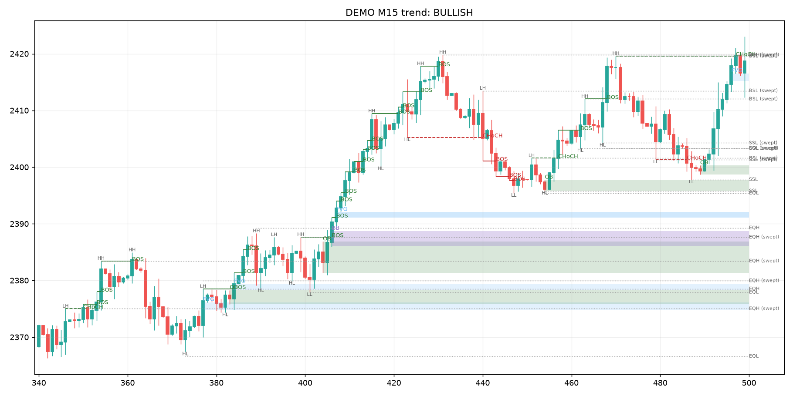

# smc-engine

[](https://github.com/Emil-02/smc-engine/actions/workflows/ci.yml)


[](https://gh-spruce.vercel.app/u/Emil-02)

**Smart Money Concepts (ICT) detection for OHLC data**, in plain pandas + NumPy.

Swings (HH/HL/LH/LL) · BOS / CHoCH · Order Blocks · Fair Value Gaps · Breaker Blocks ·
BSL / SSL · Equal Highs/Lows · Liquidity sweeps · Inducement · Premium/Discount · OTE ·
zone mitigation & invalidation · a 0–100 confluence score that explains itself.



It was extracted from a live XAU/USD signal system. The rules are deliberately explicit, so
you can read the source, check every decision and backtest without look-ahead.

## Install

```bash
pip install smc-engine            # core: numpy + pandas
pip install "smc-engine[plot]"    # + matplotlib chart
```

## Quick start

```python
import pandas as pd
import smc_engine as smc

df = pd.read_csv("XAUUSD_M15.csv", parse_dates=["time"])   # time, open, high, low, close
result = smc.analyze(df, symbol="XAUUSD", timeframe="M15")

result.trend                 # "BULLISH" / "BEARISH" / "NEUTRAL"
result.breaks_frame()        # BOS / CHoCH with levels
result.zones_frame()         # active OB / FVG / BB with context flags
result.liquidity_frame()     # BSL / SSL / EQH / EQL and sweeps

htf = {"H1": smc.ema_bias(h1_df), "H4": smc.analyze(h4_df).trend}
for zone in result.active_zones:
    score, reasons = smc.score_zone(zone, result, htf)
    print(zone.label, score, reasons)
```

Input can use any column capitalisation and either a `time` column or a `DatetimeIndex`.
Timezone-aware times are converted to naive UTC. Bar indices in the results are row positions.

Run [`examples/quickstart.py`](examples/quickstart.py) to see the full output and chart.

## What gets detected

| Concept | Rule |
|---|---|
| Swing high / low | Fractal: the strict first extreme of `±swing_lookback` bars. Labelled HH/LH and HL/LL. |
| BOS / CHoCH | A **close** beyond the protected swing. With the trend it is a BOS, against it a CHoCH. Wicks don't count, so sweeps are not mistaken for breaks. |
| Order Block | The last opposite candle (within 15 bars) before a break whose leg is ≥ `displacement_atr_mult` × ATR. |
| Fair Value Gap | Three-candle imbalance larger than `fvg_min_gap_atr` × ATR. |
| Breaker Block | An order block closed through on its far side flips polarity. |
| Liquidity | The last 5 swing highs/lows plus clusters of equal highs/lows within `eq_tolerance_pct` %. |
| Sweep | A wick through a liquidity level that closes back on the original side. |
| Inducement | A minor swing (`minor_swing_lookback`) formed after a zone, sitting between price and the zone. |
| Premium / Discount, OTE | Measured against the latest major swing range: 50% equilibrium, OTE band 61.8–79%. |
| Lifecycle | `mitigated` on the first touch (counting `touches`), `invalidated` on a close beyond the far side. |

All thresholds live in `SMCConfig`:

```python
cfg = smc.SMCConfig(swing_lookback=5, displacement_atr_mult=1.5, max_zones_per_kind=10)
result = smc.analyze(df, cfg)
```

## Building blocks

Every stage is a plain function, so you can compose your own pipeline:

```python
import smc_engine as smc

data = smc.prepare(df)                                    # normalise columns / time
swings = smc.find_swings(data, lookback=3)
breaks, trend = smc.detect_structure(data, swings, confirm_lag=3)   # point-in-time safe
obs = smc.detect_order_blocks(data, breaks, atr_val=smc.atr(data))
```

For backtests, pass `confirm_lag=swing_lookback` to `detect_structure` so a swing is only
used once it would really have been confirmed.

## Confluence score

`score_zone` adds and subtracts points for:

- higher-timeframe bias (±25)
- entry-timeframe structure
- displacement strength
- a prior liquidity sweep
- inducement
- the correct premium/discount side
- OTE
- freshness
- zone type
- RSI extremes

The result is clamped to 0–100 and comes with a list of reasons. The weights were
calibrated on XAU/USD M15 backtests. Treat them as a starting point, not financial advice.

## Development

```bash
uv sync
uv run pytest
uv run ruff check .
```

## License

[MIT](LICENSE) © Emil Rahmat
